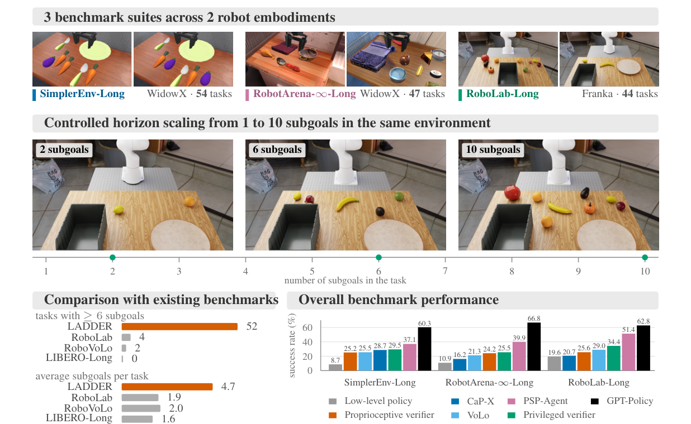
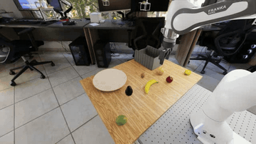
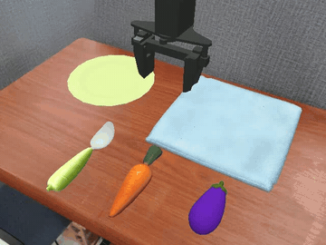
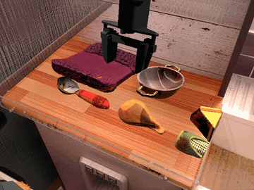
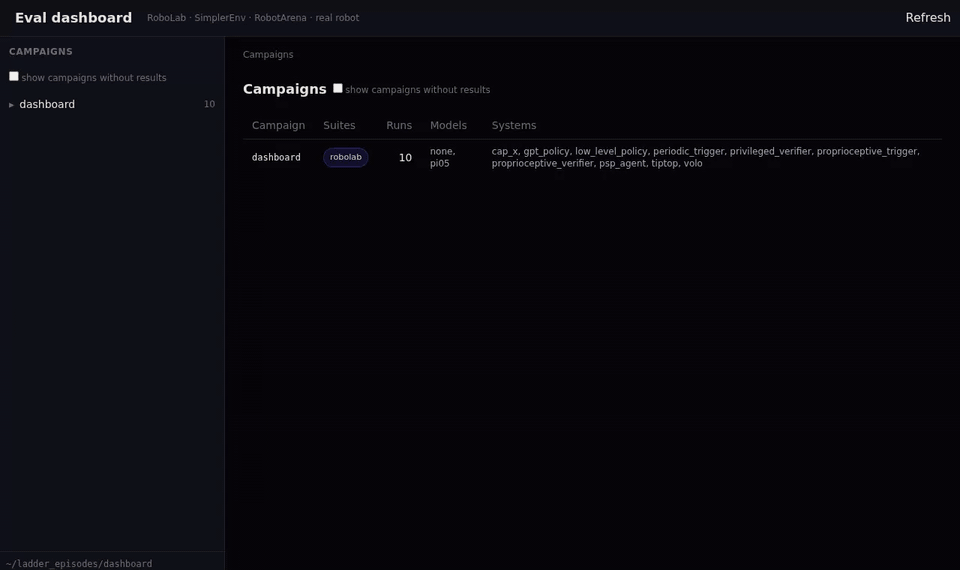
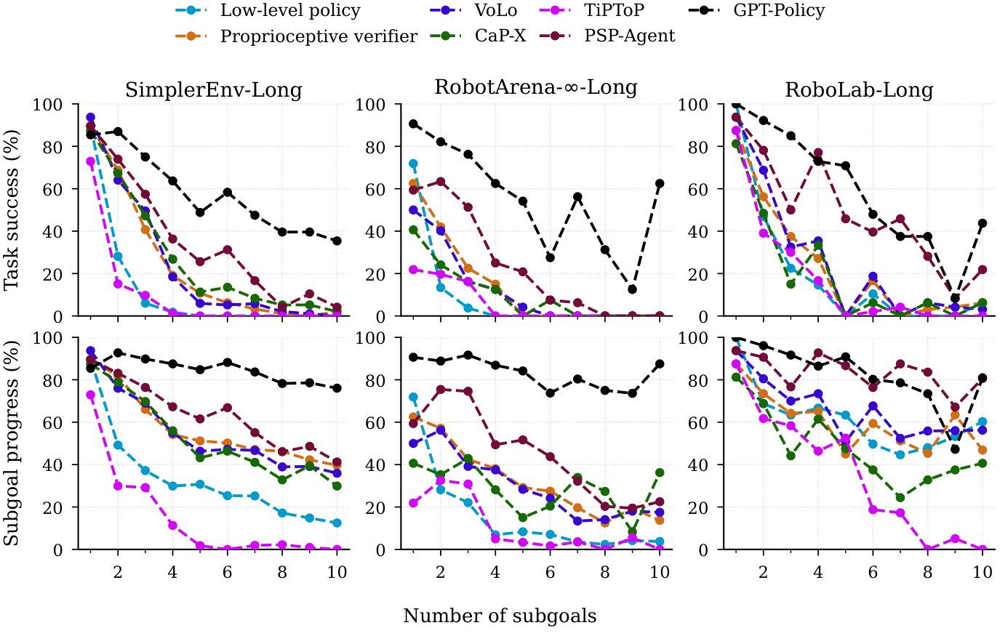

<p align="center">
  <picture>
    <source media="(prefers-color-scheme: dark)" srcset="docs/static/images/logo/ladder-logo-on-dark.svg">
    
  </picture>
</p>

<h3 align="center">A Long-Horizon Robot Manipulation Benchmark</h3>

<p align="center">
  <a href="https://ladderrobotics.ai">🌐 Website</a> ·
  <a href="https://arxiv.org/abs/2610.18053">📄 Paper</a> ·
  <a href="https://huggingface.co/collections/INSAIT-Institute/ladder-6abbbddc46691080f5d954c8">🤗 Models and datasets</a>
</p>

> [!NOTE]
> LADDER is still under heavy development. Commands and outputs may change between releases.

**LADDER** is a benchmark for long-horizon robot manipulation: 145 tasks of 1 to 10 subgoals in
three simulated suites, each subgoal checked automatically.

<div align="center">
  
</div>

## Installation

```bash
git clone https://github.com/insait-institute/ladder.git && cd ladder
```

Everything else (Bazel, Python environments, simulators, assets, the Bridge policy) is installed on
the first run.

## Running an evaluation

```bash
scripts/eval.sh --suite simplerenv_long --method privileged_verifier
```

This runs a method ([all methods](EVALUATION.md#methods)) on a suite ([all suites](EVALUATION.md#suites)),
here on its default two-subgoal task. Results and videos are written to `out/`, and the
[dashboard](#dashboard) shows them.

```bash
# specific tasks (all tasks: TASKS.md)
scripts/eval.sh --suite robolab_long --method low_level_policy --task comp_bin_2 comp_relay_3

# every task of a suite
scripts/eval.sh --suite robotarena_long --method privileged_verifier --task all

# a method that uses a vision-language model: any OpenAI-compatible endpoint
export VLM_BASE_URL=https://generativelanguage.googleapis.com/v1beta/openai/
export VLM_API_KEY=<your key>
scripts/eval.sh --suite simplerenv_long --method psp_agent
```

[EVALUATION.md](EVALUATION.md) has the remaining options.

## Evaluating your own system

A policy, an orchestrator or an agent plugs in with one short file. [`examples/`](examples/README.md)
has one of each to start from:

```bash
# a policy (e.g. a VLA), served from its own Python environment
python examples/policy_server.py --port 8000
scripts/eval.sh --suite simplerenv_long --policy-server localhost:8000 --name my_policy

# an orchestrator that instructs the suite's low-level policy, or an agent that drives the arm
scripts/eval.sh --suite simplerenv_long --orchestrator examples/orchestrator.py:PlanThenSwitch
scripts/eval.sh --suite simplerenv_long --agent examples/agent.py:PointAndPlace
```

To put it on the [leaderboard](https://ladderrobotics.ai/#leaderboard), run every task
(`--task all`), then `scripts/leaderboard.py package --name my_policy` and open a pull request
([`leaderboard/README.md`](leaderboard/README.md)).

## Tasks

[TASKS.md](TASKS.md) lists every task with its instruction and a video of it being solved.

<div align="center">
  
  
  
</div>
<p align="center"><sub>Flawless episodes from the released evaluation: GPT-Policy on tasks of 7, 10 and 8 subgoals. All play at 4&times; speed.</sub></p>

## Dashboard

The dashboard replays episodes next to their subgoals and events, and compares methods task by task.

<div align="center">
  
</div>

```bash
scripts/dashboard.sh    # open http://localhost:8080
```

The evaluation episodes of every method ([`INSAIT-Institute/LADDER-Evaluation-Episodes`](https://huggingface.co/datasets/INSAIT-Institute/LADDER-Evaluation-Episodes))
open in it too, here those of one method on one suite:

```bash
scripts/dashboard.sh fetch --suite robolab_long --method psp_agent
scripts/dashboard.sh out ~/ladder_episodes/dashboard
```

## Offline VLM benchmark

The judgements an orchestrator asks a vision-language model to make (plan decomposition, subgoal
verification, state tracking, subgoal switching), on 145 scenes and 562 frames, scored without a
simulator ([`INSAIT-Institute/LADDER-Offline-VLM-Benchmark`](https://huggingface.co/datasets/INSAIT-Institute/LADDER-Offline-VLM-Benchmark)):

```bash
scripts/vlm_benchmark.sh decomposition --model <model>
```

See [EVALUATION.md](EVALUATION.md#offline-vlm-benchmark) for the other tasks.

## Results

Task success rate (%) of the baselines, from the paper.

| method | RoboLab-Long | SimplerEnv-Long | RobotArena-&infin;-Long | all tasks |
|---|---:|---:|---:|---:|
| Low-level policy | 19.6 | 8.7 | 10.9 | 11.0 |
| Periodic trigger | 25.6 | 17.4 | 15.2 | 18.4 |
| Proprioceptive trigger | 28.1 | 21.5 | 16.2 | 21.7 |
| Proprioceptive verifier | 25.6 | 25.2 | **24.2** | 25.0 |
| VoLo | **29.0** | **25.5** | 21.3 | **25.3** |
| Privileged verifier | 34.4 | 29.5 | 25.5 | 29.6 |
| CaP-X | 20.7 | 28.7 | 16.2 | 25.0 |
| TiPToP | 17.3 | 6.7 | 11.2 | 9.4 |
| PSP-Agent | 51.4 | 37.1 | 39.9 | 40.1 |
| GPT-Policy | **62.8** | **60.3** | **66.8** | **62.0** |

<div align="center">
  
</div>

## Documentation

- [Evaluation](EVALUATION.md): suites, methods, options and the launchers behind `scripts/eval.sh`
- [Your own system](examples/README.md) and [the leaderboard](leaderboard/README.md)
- [Tasks](TASKS.md)
- [Dashboard](ladder/components/dashboard/README.md)
- [Metrics](ladder/components/inference/api/client/metrics/README.md)

## Tested setup

Debian 13 with NVIDIA RTX A6000, H200 and RTX PRO 6000 GPUs, and an RTX 3090.

## License

The code and the Bridge policy are released under the [MIT License](LICENSE), and the evaluation
episodes under [CC BY 4.0](https://creativecommons.org/licenses/by/4.0/). Third-party components are
listed in [EVALUATION.md](EVALUATION.md#licenses-of-external-components).

## Citation

```bibtex
@article{ladder2026,
  title   = {{LADDER}: A Long-Horizon Robot Manipulation Benchmark},
  author  = {Petkov, Petko and Albanese, Giuliano and Nikolov, Nikolay and Van Gool, Luc and Tremblay, Jonathan and Paudel, Danda Pani},
  journal = {arXiv preprint arXiv:2610.18053},
  year    = {2026},
  url     = {https://arxiv.org/abs/2610.18053}
}
```

## Contributing

See [CONTRIBUTING.md](CONTRIBUTING.md).
