# Tasks

Every task of the three suites. Pass its name to `scripts/eval.sh --task`. The videos show the
scripted policy (`--method scripted`) solving each task from the simulator's ground-truth state.

[SimplerEnv-Long](#simplerenv_long) · [RobotArena-&infin;-Long](#robotarena_long) · [RoboLab-Long](#robolab_long)

## simplerenv_long

SimplerEnv-Long, 54 tasks.

| | task | instruction | subgoals |
|---|---|---|:-:|
| 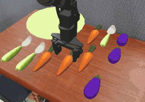 | `all10_plate` | Put the four carrots, the three spoons and the three eggplants on the plate. | 10 |
| 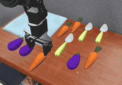 | `all10_towel` | Put the four carrots, the three spoons and the three eggplants on the blue towel. | 10 |
| 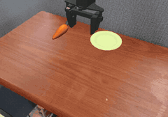 | `all1_plate` | Put the carrot on the plate. | 1 |
| 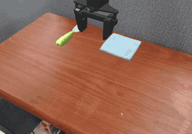 | `all1_towel` | Put the spoon on the blue towel. | 1 |
| 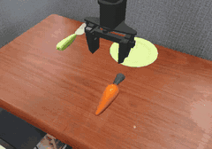 | `all2_plate` | Put the carrot and the spoon on the plate. | 2 |
| 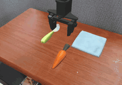 | `all2_towel` | Put the carrot and the spoon on the blue towel. | 2 |
| 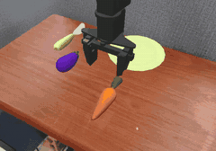 | `all3_plate` | Put the carrot, the spoon and the eggplant on the plate. | 3 |
| 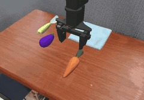 | `all3_towel` | Put the carrot, the spoon and the eggplant on the blue towel. | 3 |
| 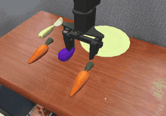 | `all4_plate` | Put both carrots, the spoon and the eggplant on the plate. | 4 |
| 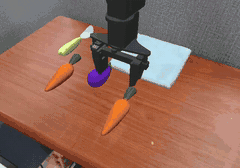 | `all4_towel` | Put both carrots, the spoon and the eggplant on the blue towel. | 4 |
| 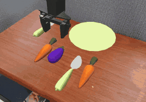 | `all5_plate` | Put both carrots, both spoons and the eggplant on the plate. | 5 |
| 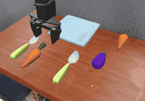 | `all5_towel` | Put both carrots, both spoons and the eggplant on the blue towel. | 5 |
| 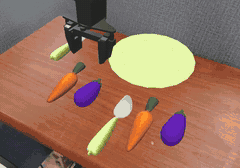 | `all6_plate` | Put both carrots, both spoons and both eggplants on the plate. | 6 |
| 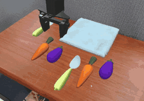 | `all6_towel` | Put both carrots, both spoons and both eggplants on the blue towel. | 6 |
| 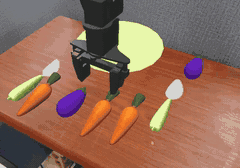 | `all7_plate` | Put the three carrots, both spoons and both eggplants on the plate. | 7 |
| 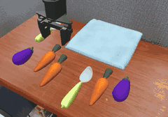 | `all7_towel` | Put the three carrots, both spoons and both eggplants on the blue towel. | 7 |
| 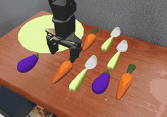 | `all8_plate` | Put the three carrots, the three spoons and both eggplants on the plate. | 8 |
| 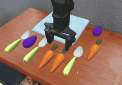 | `all8_towel` | Put the three carrots, the three spoons and both eggplants on the blue towel. | 8 |
| 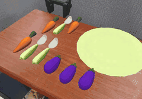 | `all9_plate` | Put the three carrots, the three spoons and the three eggplants on the plate. | 9 |
| 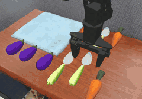 | `all9_towel` | Put the three carrots, the three spoons and the three eggplants on the blue towel. | 9 |
| 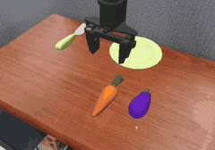 | `except_eggplant_2` | Put everything except the eggplant on the plate. | 2 |
| 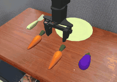 | `except_eggplant_3` | Put everything except the eggplant on the plate. | 3 |
| 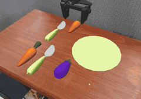 | `except_eggplant_4` | Put everything except the eggplant on the plate. | 4 |
| 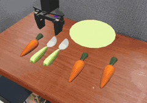 | `except_eggplant_5` | Put everything except the eggplant on the plate. | 5 |
| 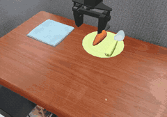 | `move_plate_to_towel_2` | Move the carrot and the spoon from the plate to the blue towel. | 2 |
| 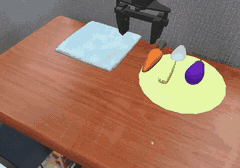 | `move_plate_to_towel_3` | Move the carrot, the spoon and the eggplant from the plate to the blue towel. | 3 |
| 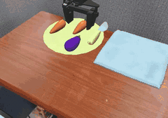 | `move_plate_to_towel_4` | Move both carrots, the spoon and the eggplant from the plate to the blue towel. | 4 |
| 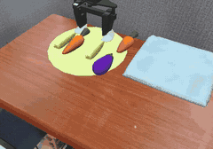 | `move_plate_to_towel_5` | Move both carrots, both spoons and the eggplant from the plate to the blue towel. | 5 |
| 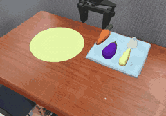 | `move_towel_to_plate_3` | Move the carrot, the spoon and the eggplant from the blue towel to the plate. | 3 |
| 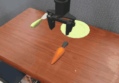 | `ordered_plate_2` | First put the carrot on the plate, then put the spoon on the plate. | 2 |
| 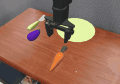 | `ordered_plate_3` | First put the carrot on the plate, then put the spoon on the plate, then put the eggplant on the plate. | 3 |
| 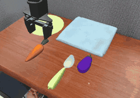 | `relay10e` | First put the carrot on the plate, then put the carrot on the blue towel, then put the spoon on the plate, then put the spoon on the blue towel, then put the eggplant on the plate, then put the eggplant on the blue towel, then put the carrot on the plate, then put the carrot on the blue towel, then put the spoon on the plate, then put the spoon on the blue towel. | 10 |
| 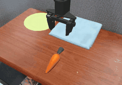 | `relay2e` | First put the carrot on the plate, then put the carrot on the blue towel. | 2 |
| 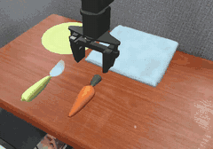 | `relay3e` | First put the carrot on the plate, then put the carrot on the blue towel, then put the spoon on the plate. | 3 |
| 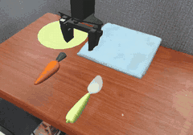 | `relay4e` | First put the carrot on the plate, then put the carrot on the blue towel, then put the spoon on the plate, then put the spoon on the blue towel. | 4 |
| 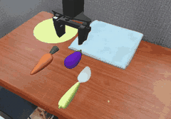 | `relay5e` | First put the carrot on the plate, then put the carrot on the blue towel, then put the spoon on the plate, then put the spoon on the blue towel, then put the eggplant on the plate. | 5 |
| 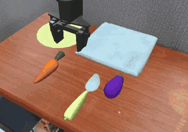 | `relay6e` | First put the carrot on the plate, then put the carrot on the blue towel, then put the spoon on the plate, then put the spoon on the blue towel, then put the eggplant on the plate, then put the eggplant on the blue towel. | 6 |
|  | `relay7e` | First put the carrot on the plate, then put the carrot on the blue towel, then put the spoon on the plate, then put the spoon on the blue towel, then put the eggplant on the plate, then put the eggplant on the blue towel, then put the carrot on the plate. | 7 |
| 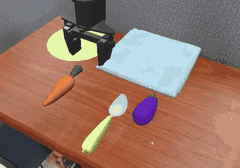 | `relay8e` | First put the carrot on the plate, then put the carrot on the blue towel, then put the spoon on the plate, then put the spoon on the blue towel, then put the eggplant on the plate, then put the eggplant on the blue towel, then put the carrot on the plate, then put the carrot on the blue towel. | 8 |
| 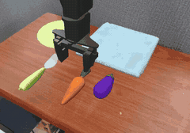 | `relay9e` | First put the carrot on the plate, then put the carrot on the blue towel, then put the spoon on the plate, then put the spoon on the blue towel, then put the eggplant on the plate, then put the eggplant on the blue towel, then put the carrot on the plate, then put the carrot on the blue towel, then put the spoon on the plate. | 9 |
| 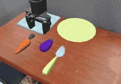 | `shuttle10` | First put the carrot on the plate, then put the spoon on the plate, then put the eggplant on the plate, then put the carrot on the blue towel, then put the spoon on the blue towel, then put the eggplant on the blue towel, then put the carrot on the plate, then put the spoon on the plate, then put the eggplant on the plate, then put the carrot on the blue towel. | 10 |
| 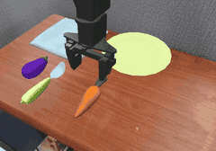 | `shuttle7` | First put the carrot on the plate, then put the spoon on the plate, then put the eggplant on the plate, then put the carrot on the blue towel, then put the spoon on the blue towel, then put the eggplant on the blue towel, then put the carrot on the plate. | 7 |
| 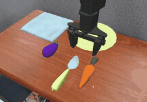 | `shuttle8` | First put the carrot on the plate, then put the spoon on the plate, then put the eggplant on the plate, then put the carrot on the blue towel, then put the spoon on the blue towel, then put the eggplant on the blue towel, then put the carrot on the plate, then put the spoon on the plate. | 8 |
| 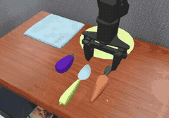 | `shuttle9` | First put the carrot on the plate, then put the spoon on the plate, then put the eggplant on the plate, then put the carrot on the blue towel, then put the spoon on the blue towel, then put the eggplant on the blue towel, then put the carrot on the plate, then put the spoon on the plate, then put the eggplant on the plate. | 9 |
| 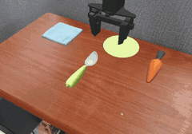 | `split2` | Put the carrot on the plate and put the spoon on the blue towel. | 2 |
| 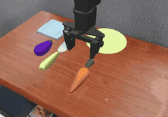 | `split3` | Put the carrot and the spoon on the plate and put the eggplant on the blue towel. | 3 |
| 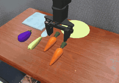 | `split4` | Put one carrot and the spoon on the plate and put the eggplant and one carrot on the blue towel. | 4 |
| 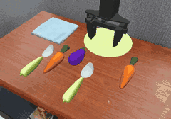 | `split5` | Put one carrot, one spoon and the eggplant on the plate and put one carrot and one spoon on the blue towel. | 5 |
| 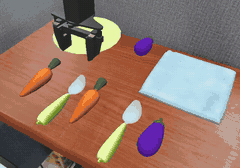 | `split6` | Put one carrot, one spoon and one eggplant on the plate and put one carrot, one spoon and one eggplant on the blue towel. | 6 |
| 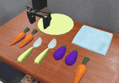 | `split7` | Put two carrots, one spoon and one eggplant on the plate and put one spoon, one eggplant and one carrot on the blue towel. | 7 |
| 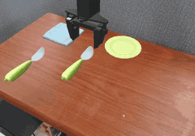 | `spoons2` | Put one spoon on the plate and put one spoon on the blue towel. | 2 |
|  | `spoons3` | Put two spoons on the plate and put one spoon on the blue towel. | 3 |
|  | `spoons4` | Put two spoons on the plate and put two spoons on the blue towel. | 4 |
|  | `spoons5` | Put three spoons on the plate and put two spoons on the blue towel. | 5 |

## robotarena_long

RobotArena-&infin;-Long, 47 tasks.

| | task | instruction | subgoals |
|---|---|---|:-:|
|  | `scene36_1goal` | Put the fork in the pan. | 1 |
|  | `scene36_2goal` | Put the fork and the corn cob in the pan. | 2 |
|  | `scene45_1goal` | Put the blue bowl on the purple cloth. | 1 |
|  | `scene45_2goal` | Put the blue bowl and the sushi toy on the purple cloth. | 2 |
|  | `scene45_3goal` | Put the blue bowl, the sushi toy and the banana on the purple cloth. | 3 |
|  | `scene45_4goal` | Put the blue bowl, the sushi toy, the cheese and the banana on the purple cloth. | 4 |
|  | `scene45_5goal` | Put the blue bowl, the sushi toy, the cheese, the banana and the mushroom on the purple cloth. | 5 |
|  | `scene45_6goal` | Put the blue bowl, the sushi toy, the cheese, the banana, the mushroom and the corn cob on the purple cloth. | 6 |
|  | `scene45_all_2` | Put the blue bowl and the sushi toy on the purple cloth. | 2 |
|  | `scene45_all_3` | Put the blue bowl, the sushi toy and the banana on the purple cloth. | 3 |
|  | `scene45_all_4` | Put the blue bowl, the sushi toy, the banana and the cheese on the purple cloth. | 4 |
|  | `scene45_all_5` | Put the blue bowl, the sushi toy, the banana, the cheese and the mushroom on the purple cloth. | 5 |
|  | `scene45_all_6` | Put the blue bowl, the sushi toy, the banana, the cheese, the mushroom and the corn cob on the purple cloth. | 6 |
|  | `scene45_except_2` | Put everything except the small can on the purple cloth. | 2 |
|  | `scene45_except_3` | Put everything except the small can on the purple cloth. | 3 |
|  | `scene45_except_4` | Put everything except the small can on the purple cloth. | 4 |
|  | `scene45_except_5` | Put everything except the small can on the purple cloth. | 5 |
|  | `scene45_except_6` | Put everything except the small can on the purple cloth. | 6 |
|  | `scene50_3goal` | Put the stuffed animal, the blue block and the cheese in the pot. | 3 |
|  | `scene54_1goal` | Put the spoon on the cloth. | 1 |
|  | `scene54_2goal` | Put the spoon and the chicken drumstick on the cloth. | 2 |
|  | `scene54_2goal_ordered` | First put the chicken drumstick on the cloth, then put the spoon on the cloth. | 2 |
|  | `scene54_3goal` | Put the spoon, the chicken drumstick and the pot on the cloth. | 3 |
|  | `scene54_3goal_ordered` | First put the corn cob on the cloth, then put the spoon on the cloth, then put the chicken drumstick on the cloth. | 3 |
|  | `scene54_duplicates_2` | Put both corn cobs on the cloth. | 2 |
|  | `scene54_duplicates_3` | Put the three corn cobs on the cloth. | 3 |
|  | `scene54_except` | Put everything except the pot on the cloth. | 2 |
|  | `scene54_except_3` | Put everything except the pot on the cloth. | 3 |
|  | `scene54_relay_2` | First put the spoon on the cloth, then put the spoon in the pot. | 2 |
|  | `scene54_relay_4` | First put the spoon on the cloth, then put the spoon in the pot, then put the chicken drumstick on the cloth, then put the chicken drumstick in the pot. | 4 |
|  | `scene54_revisit_10` | First put the spoon on the cloth, then put the spoon in the pot, then put the spoon on the cloth, then put the spoon in the pot, then put the spoon on the cloth, then put the spoon in the pot, then put the spoon on the cloth, then put the spoon in the pot, then put the spoon on the cloth, then put the spoon in the pot. | 10 |
|  | `scene54_revisit_3` | First put the spoon on the cloth, then put the spoon in the pot, then put the spoon on the cloth. | 3 |
|  | `scene54_revisit_6` | First put the spoon on the cloth, then put the spoon in the pot, then put the spoon on the cloth, then put the chicken drumstick on the cloth, then put the chicken drumstick in the pot, then put the chicken drumstick on the cloth. | 6 |
|  | `scene54_revisit_7` | First put the spoon on the cloth, then put the spoon in the pot, then put the spoon on the cloth, then put the spoon in the pot, then put the spoon on the cloth, then put the spoon in the pot, then put the spoon on the cloth. | 7 |
|  | `scene54_revisit_8` | First put the spoon on the cloth, then put the spoon in the pot, then put the spoon on the cloth, then put the spoon in the pot, then put the spoon on the cloth, then put the spoon in the pot, then put the spoon on the cloth, then put the spoon in the pot. | 8 |
|  | `scene54_revisit_9` | First put the spoon on the cloth, then put the spoon in the pot, then put the spoon on the cloth, then put the chicken drumstick on the cloth, then put the chicken drumstick in the pot, then put the chicken drumstick on the cloth, then put the corn cob on the cloth, then put the corn cob in the pot, then put the corn cob on the cloth. | 9 |
|  | `scene54_route_2` | First put the spoon in the pot, then put the spoon on the cloth. | 2 |
|  | `scene54_route_4` | First put the spoon in the pot, then put the spoon on the cloth, then put the chicken drumstick in the pot, then put the chicken drumstick on the cloth. | 4 |
|  | `scene54_route_6` | First put the spoon in the pot, then put the spoon on the cloth, then put the chicken drumstick in the pot, then put the chicken drumstick on the cloth, then put the corn cob in the pot, then put the corn cob on the cloth. | 6 |
|  | `scene54_route_7` | First put the spoon in the pot, then put the spoon on the cloth, then put the chicken drumstick in the pot, then put the chicken drumstick on the cloth, then put the corn cob in the pot, then put the corn cob on the cloth, then put the cheese on the cloth. | 7 |
|  | `scene54_route_8` | First put the spoon in the pot, then put the spoon on the cloth, then put the chicken drumstick in the pot, then put the chicken drumstick on the cloth, then put the corn cob in the pot, then put the corn cob on the cloth, then put the cheese in the pot, then put the cheese on the cloth. | 8 |
|  | `scene54_split_2` | Put the spoon on the cloth and put the chicken drumstick in the pot. | 2 |
|  | `scene54_split_3` | Put the spoon and the corn cob on the cloth and put the chicken drumstick in the pot. | 3 |
|  | `scene54_transfer_2` | Move the spoon and the chicken drumstick from the cloth to the pot. | 2 |
|  | `scene76_1goal` | Put the metal pot on the yellow cloth. | 1 |
|  | `scene76_2goal` | Put the metal pot and the mushroom toy on the yellow cloth. | 2 |
|  | `scene76_2goal_ordered` | First put the metal pot on the yellow cloth, then put the mushroom toy on the yellow cloth. | 2 |

## robolab_long

RoboLab-Long, 44 tasks.

| | task | instruction | subgoals |
|---|---|---|:-:|
|  | `comp_bin_1` | Put the banana in the bin. | 1 |
|  | `comp_bin_10` | Put the banana, both oranges, the lemon, the lime, the avocado, the onion, the lychee, the pumpkin and the pomegranate in the bin. | 10 |
|  | `comp_bin_2` | Put the banana and the orange in the bin. | 2 |
|  | `comp_bin_2_distractor` | Put everything except the red block in the bin. | 2 |
|  | `comp_bin_4_distractor` | Put everything except the red block and the blue block in the bin. | 4 |
|  | `comp_bin_6` | Put the banana, the orange, the lemon, the lime, the avocado and the onion in the bin. | 6 |
|  | `comp_identical_2` | Put both oranges in the bin. | 2 |
|  | `comp_identical_4` | Put the four limes in the bin. | 4 |
|  | `comp_ordered_bin_10` | First put the pumpkin in the bin, then put the onion in the bin, then put the lime in the bin, then put the avocado in the bin, then put the lemon in the bin, then put the pomegranate in the bin, then put the lychee in the bin, then put the banana in the bin, then put the orange in the bin, then put the orange in the bin. | 10 |
|  | `comp_ordered_bin_2` | First put the banana in the bin, then put the orange in the bin. | 2 |
|  | `comp_ordered_bin_3` | First put the banana in the bin, then put the lemon in the bin, then put the orange in the bin. | 3 |
|  | `comp_ordered_bin_4` | First put the orange in the bin, then put the lemon in the bin, then put the lime in the bin, then put the banana in the bin. | 4 |
|  | `comp_ordered_bin_5` | First put the avocado in the bin, then put the orange in the bin, then put the lemon in the bin, then put the lime in the bin, then put the banana in the bin. | 5 |
|  | `comp_ordered_bin_6` | First put the avocado in the bin, then put the orange in the bin, then put the lemon in the bin, then put the lime in the bin, then put the onion in the bin, then put the banana in the bin. | 6 |
|  | `comp_ordered_bin_7` | First put the avocado in the bin, then put the orange in the bin, then put the lemon in the bin, then put the lime in the bin, then put the onion in the bin, then put the banana in the bin, then put the lychee in the bin. | 7 |
|  | `comp_ordered_bin_8` | First put the orange in the bin, then put the pumpkin in the bin, then put the lychee in the bin, then put the lemon in the bin, then put the lime in the bin, then put the banana in the bin, then put the onion in the bin, then put the avocado in the bin. | 8 |
|  | `comp_ordered_bin_9` | First put the onion in the bin, then put the orange in the bin, then put the pumpkin in the bin, then put the lychee in the bin, then put the lemon in the bin, then put the lime in the bin, then put the banana in the bin, then put the avocado in the bin, then put the orange in the bin. | 9 |
|  | `comp_plate_1` | Put the banana on the plate. | 1 |
|  | `comp_relay_2` | First put the lemon on the plate, then put the lemon in the bin, then put the lime on the plate, then put the lime in the bin. | 4 |
|  | `comp_relay_3` | First put the lemon on the plate, then put the lemon in the bin, then put the lime on the plate, then put the lime in the bin, then put the banana on the plate, then put the banana in the bin. | 6 |
|  | `comp_relay_4` | First put the lemon on the plate, then put the lemon in the bin, then put the lime on the plate, then put the lime in the bin, then put the banana on the plate, then put the banana in the bin, then put the orange on the plate, then put the orange in the bin. | 8 |
|  | `comp_relay_5` | First put the lemon on the plate, then put the lemon in the bin, then put the lime on the plate, then put the lime in the bin, then put the banana on the plate, then put the banana in the bin, then put the orange on the plate, then put the orange in the bin, then put the avocado on the plate, then put the avocado in the bin. | 10 |
|  | `comp_revisit_1` | First put the lemon in the bin, then put the lemon on the plate, then put the lemon in the bin. | 3 |
|  | `comp_revisit_2` | First put the lemon in the bin, then put the lemon on the plate, then put the lemon in the bin, then put the lime in the bin, then put the lime on the plate, then put the lime in the bin. | 6 |
|  | `comp_revisit_3` | First put the lemon in the bin, then put the lemon on the plate, then put the lemon in the bin, then put the lime in the bin, then put the lime on the plate, then put the lime in the bin, then put the banana in the bin, then put the banana on the plate, then put the banana in the bin. | 9 |
|  | `comp_route_10` | Put the banana, the lemon and the lime on the plate and put both oranges, the avocado, the onion, the lychee, the pumpkin and the pomegranate in the bin. | 10 |
|  | `comp_route_2` | Put the lemon on the plate and put the orange in the bin. | 2 |
|  | `comp_route_2_binfirst` | Put the orange in the bin and put the lemon on the plate. | 2 |
|  | `comp_route_3` | Put the lemon and the lime on the plate and put the orange in the bin. | 3 |
|  | `comp_route_4` | Put the lemon and the lime on the plate and put the orange and the avocado in the bin. | 4 |
|  | `comp_route_5` | Put the lemon, the lime and the banana on the plate and put the orange and the avocado in the bin. | 5 |
|  | `comp_route_6` | Put the lemon, the lime and the banana on the plate and put the orange, the avocado and the onion in the bin. | 6 |
|  | `comp_route_7` | Put the banana, the lemon and the lime on the plate and put the orange, the avocado, the onion and the lychee in the bin. | 7 |
|  | `comp_route_8` | Put the banana, the lemon and the lime on the plate and put the orange, the avocado, the onion, the lychee and the pumpkin in the bin. | 8 |
|  | `comp_route_9` | Put the banana, the lemon and the lime on the plate and put both oranges, the avocado, the onion, the lychee and the pumpkin in the bin. | 9 |
|  | `comp_split_plate_2` | Put the avocado on the plate and put the orange in the bin. | 2 |
|  | `comp_split_plate_3` | Put the avocado and the banana on the plate and put the orange in the bin. | 3 |
|  | `comp_split_plate_4` | Put the avocado and the banana on the plate and put the orange and the lime in the bin. | 4 |
|  | `comp_split_plate_5` | Put the avocado and the banana on the plate and put the orange, the onion and the lychee in the bin. | 5 |
|  | `comp_split_plate_6` | Put the avocado, the banana and the lemon on the plate and put the orange, the lime and the onion in the bin. | 6 |
|  | `comp_split_plate_7` | Put the avocado, the banana and the lemon on the plate and put the orange, the lime, the onion and the lychee in the bin. | 7 |
|  | `comp_split_plate_8` | Put the avocado, the banana, the lemon and the lime on the plate and put the orange, the onion, the lychee and the pumpkin in the bin. | 8 |
|  | `comp_transfer_2` | Move the orange and the lemon from the plate to the bin. | 2 |
|  | `comp_transfer_3` | Move the orange, the lemon and the lime from the plate to the bin. | 3 |
