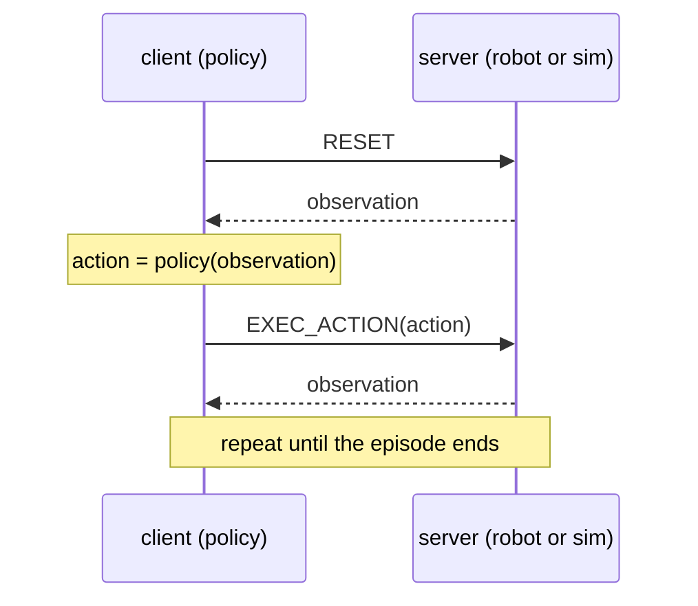

# Robot inference

This package provides standardized interfaces for robot inference: running a trained model on a
real or simulated robot, in real time.

## Design

### The protocol

A robot integration (real hardware or a simulator) runs as a server process. A model runs inside a
client process and talks to that server over the network. Server and client can run on different
machines: the server needs to be near the robot (or the simulator), and the client needs whatever
GPU and ML libraries the model requires. This also keeps their pip dependencies apart: a robot's
driver requirements do not need to be compatible with a model's, since server and client never
share a python environment.

The two sides agree on one shared wire protocol: a request, `RESET`, `GET_OBSERVATIONS`,
`EXEC_ACTION`, `CONNECT` or `EXIT`, gets a reply back. Requests and replies are typed observation
and action objects, converted to plain dictionaries and sent as `msgpack` bytes over `ZMQ`
(a lightweight network messaging library) sockets. A typical control loop looks like this:

Because that protocol is the actual contract, not any particular Python class, a policy client
written once (`api/client/robot_env.py`'s `RobotEnv`) works unmodified against any server that
speaks it, whichever physics simulator runs behind it. Swapping one simulator for another,
or running the same evaluation against several simulator backends,
needs no client-side code changes.

### Plugging in a model

A model is any class implementing the `Policy` protocol (`api/client/policy.py`): given an
observation, return an action. There is no persistent model server by default; a checkpoint is
loaded directly in the client process, together with the exact model source code that was used to
train it (exported alongside the weights), so inference does not depend on the training code.
An optional shared batch-inference server exists purely to raise throughput when many simulated
environments run in parallel against one GPU; it is an optimization, not a required part of the
design.

## Pip environments
Server and client environments are explicitly separated to allow for easily integrating a new robot or a new model which might have some very specific pip requirements which are incompatible with other robot or model environments.
