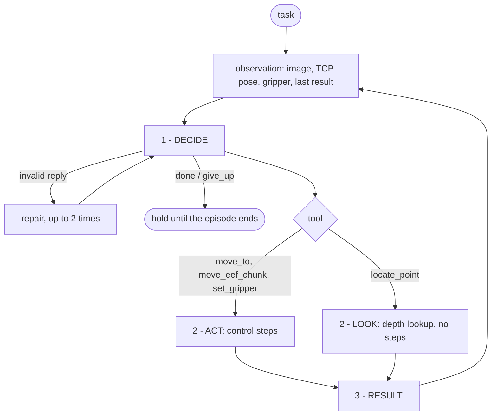

# GPT-Policy

Runs [cheng-haha/GPT-Policy](https://github.com/cheng-haha/GPT-Policy) as a ladder `Policy`. A
vision-language model (VLM) reads the task, the camera image and the result of its last tool call,
and answers with exactly one robot tool call. Nothing is trained.

Upstream's agent loop, tool catalog and pose helpers are used as written. ladder supplies the host
that executes the tools and the VLM client, so any ladder VLM works.

## The loop



**1 - DECIDE.** One model call. In: the system prompt (robot, frame conventions, cameras, tool
schemas), the last 6 turns (only the most recent keeps its image) and the current observation. Out: one
JSON tool selection, for example:

```json
{"name": "move_to", "arguments": {"target": {"pose_xyzquat": [0.30, 0.05, 0.12, 1, 0, 0, 0]}, "note": "approach"}}
```

Common shape slips (arguments flattened beside the name, a Markdown fence, one pixel not wrapped in
a list) are fixed before validation. Anything else goes back to the model with the error.

**2 - ACT / LOOK.**

- `move_to` and `move_eef_chunk` densify the straight-line path to each waypoint and send one
  absolute end-effector pose per control step, then hold the last pose until the arm stops.
  Targets are clamped to the workspace.
- `set_gripper` commands the opening until the jaws stop moving.
- `locate_point` turns pixels in the shown image into base-frame points, using the published depth
  and camera calibration. It spends no simulator steps.

**3 - RESULT.** The target, the measured pose and the residual are handed back in the next
observation, so the model sees where the arm actually went.

The simulator does not advance while the model thinks. Each episode runs on its own thread under
`api/client/program.ProgramRunner`, so the model calls of all environments overlap.

## Layout

| path | what it is |
| --- | --- |
| `policy.py` | the `Policy`, one program per environment |
| `protocol.py` | the system prompt, the tool catalog and reply normalisation |
| `session.py` | upstream's agent session, answered by a ladder VLM |
| `host.py` | executes the tools on the simulated arm, and `locate_point` |
| `configs/` | the VLM (gpt-6-astra, through `VLM_BASE_URL`) and one config per benchmark |

## Running

It needs depth, serves no checkpoint and brings its own entry point:

```bash
M=ladder/components/inference/models
# SimplerEnv-Long
RUN_MODEL=models/gpt_policy:run_model PUBLISH_DEPTH=True NO_VLA=1 \
SESSION_NAME=gpt_policy ENV_NAMES=all2_plate N_ENVS=8 VIDEO=True OUT_ROOT=$PWD/out/simpler/gpt_policy \
SIM_CONFIG=ladder/components/inference/robots/simpler/configs/widowx_composition.yaml \
SIMPLER_CONFIG=$M/gpt_policy/configs/simpler/composition/gpt_policy_simpler_composition.yaml \
bash $M/vlams/scripts/vlam_simpler_bridge.sh

# RobotArena-Long
RUN_MODEL=models/gpt_policy:run_model PUBLISH_DEPTH=True NO_VLA=1 \
SESSION_NAME=gpt_policy SCENES=scene54_split_2 CAMPAIGN_ROOT=$PWD/out/robot_arena/gpt_policy \
RA_SERVER_CONFIG=ladder/components/inference/robots/robot_arena/configs/widowx_composition_k8.yaml \
RA_CLIENT_CONFIG=$M/gpt_policy/configs/robot_arena/composition/gpt_policy_robot_arena_composition.yaml \
bash $M/vlams/scripts/vlam_robot_arena.sh

# RoboLab-Long
RUN_MODEL=models/gpt_policy:run_model PUBLISH_DEPTH=True INFERENCE_SERVER=0 \
TASKS=comp_bin_2 NUM_ENVS=8 NUM_RUNS=1 CAMPAIGN_ROOT=$PWD/out/robolab/gpt_policy \
LADDER_CONFIG=$M/gpt_policy/configs/robolab/composition/gpt_policy_robolab_composition.yaml \
bash ladder/components/inference/robots/robolab/scripts/vlam_robolab.sh
```

## Upstream license

The upstream repository has no license yet. It is fetched at build time by pinned commit, and
nothing from it is committed here.
