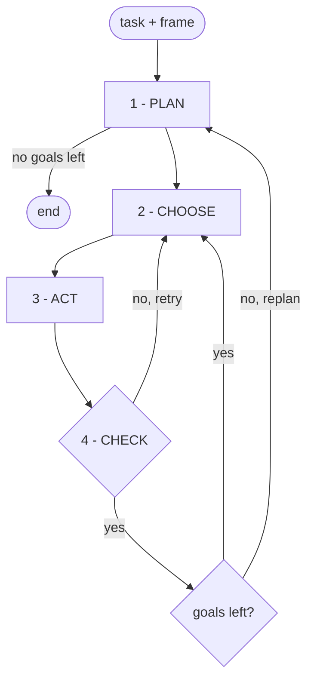

# Harness

A vision-language model (VLM) plans a task into goals, then runs each goal to completion over a
small set of verified manipulation tools.

It is a `Policy`, not an orchestrator driving a learned one. The tools emit the actions, so the
object a goal names is the object acted on. No checkpoint is served, and no GPU is needed.

## The loop



Three model calls per goal at most -- plan, choose, and one box to ground each name -- and step 4
makes none. Every reply is strict JSON. The examples below are made up; the shapes are the real ones.

**1 - PLAN.** Once per pass. In: the frame, the task, and every goal already tried with what came
back. Out:

```json
{"goals": [{"goal": "put the yellow lemon in the blue bin",
            "object": "the yellow lemon", "destination": "the blue bin"},
           {"goal": "put the red apple on the white plate",
            "object": "the red apple", "destination": "the white plate"}]}
```

Objects are named by colour and kind, because that name is what gets pointed at later. An empty
list ends the episode.

**2 - CHOOSE.** Once per attempt. In: the frame, one goal, whether the gripper is holding anything,
the tool catalog, and the calls already tried on this goal. Out:

```json
{"tool": "pick_and_place", "args": {"object_name": "the yellow lemon",
                                    "destination_name": "the blue bin"}}
```

Skipped on the first attempt, because a goal that already names an object and a destination *is* a
`pick_and_place`.

**3 - ACT.** The tool asks for a box for each name it has to find, and gets back every nearby object
too, so the right one can be told apart:

```json
[{"box_2d": [412, 230, 498, 310], "label": "the yellow lemon"},
 {"box_2d": [400, 190, 470, 260], "label": "the green lime"}]
```

`[ymin, xmin, ymax, xmax]`, normalised to 0-1000 -- y first. `best_match` takes the box whose label
answers the name; the rest are kept as rivals.

*Box to solid.* Pixels inside the box are unprojected into the robot base frame, then cut:

- non-finite, or more than 2.5 m / less than 5 cm from the camera
- within 12 cm of the hand laterally *and* not below it (2 cm, or 5 cm while carrying, so the
  object in the jaws is not erased with the fingers)
- within 6 mm of the support plane, unless the target IS a surface
- more than 8 cm behind the nearest surface in the box
- inside a rival box

What survives is clustered for contiguity around the ray through the box middle -- which separates
two touching lemons -- and fitted to an upright solid closed down to the support plane, since only
the top shell is visible from above. Out: centre, extent, yaw. The plane is the modal bin of the
cloud's z histogram.

*Solid to motion.* Grasp point = the fitted centre, height from the extent, yaw turning the jaws
across the narrowest span. `transit_to` rises above the tallest measured point in the corridor,
travels, descends. Each leg issues `EndEffectorPoseAction(translation, rotation)` every step until
the pose is inside the arrive tolerance or stops improving; the gripper rides in the same
`ManipulatorAction`. No motion planner and no simulator collision scene -- the obstacle set is the
observed cloud.

Nothing below that is ours: the action is an *absolute end-effector pose in the base frame*, the same
action a learned policy emits on the same wire protocol, and the backend does the IK and the joint
tracking -- ManiSkill3's absolute `PDEEPoseController` on SimplerEnv, Franka IK on RoboLab. With
`blocking_waypoint` the same target is re-issued every step until the arm arrives; otherwise the
step is capped at `max_translation_per_step_m`. A leg gives up after `move_steps`.

Depth is read through `RobotObservation.cameras`: the simulator's render in sim, and on a real rig
whatever depth the robot's camera is published with.

**4 - CHECK.** No model call. The tool returns `ok` and a sentence:

```
ok=True   released over 'the blue bin'
ok=False  released over 'the white plate' but it is not there: the column
          reads 0.041 against 0.088. Pick it up again.
```

That sentence is fed back verbatim under `Already tried on this goal:`, so the next CHOOSE sees what
the last one cost.

A goal gets two attempts before the loop moves on, so one impossible object cannot consume the
episode. When the plan is spent the task is planned again from a fresh frame, and the episode ends
when that plan comes back empty or nothing moved.

## Layout

| path | what it is |
| --- | --- |
| `policy.py` | the `Policy` contract, one lane per environment |
| `agent.py` | the loop above |
| `prompts.py` | every question put to the model |
| `arm.py` | blocking Cartesian primitives: transit, approach, verified grasp |
| `tools/tools.py` | the tools the model drives: each one's signature and docstring IS its prompt |
| `tools/hands.py` | what a tool acts through: the arm, the scene, and what is held |
| `tools/grasping.py` | the approach, the close, and the hold check |
| `tools/placing.py` | releasing over a destination, and checking it landed |
| `tools/pushing.py` | sliding something too wide to grasp |
| `tools/code.py` | running model-written Python against the same API |
| `tools/geometry.py` | where to grasp, and where to release |
| `perception/scene.py` | one snapshot: the cloud, the support plane, and `locate` |
| `perception/detection.py` | one object's measurements: sections, foot, top, grip point |
| `perception/fitting.py` | points to an upright box, and instance separation |
| `perception/boxes.py` | parsing the model's boxes, and picking the one that was asked for |

## Running it

| config | suite |
| --- | --- |
| `configs/robolab/composition/harness_robolab_composition.yaml` | RoboLab (Franka) |
| `configs/robot_arena/composition/harness_robot_arena_composition.yaml` | RobotArena (WidowX) |
| `configs/simpler/composition/harness_simpler_composition.yaml` | SimplerEnv (WidowX) |

Set `RUN_MODEL=models/harness:run_model` and `PUBLISH_DEPTH=True`. RoboLab also needs
`INFERENCE_SERVER=0`; RobotArena and SimplerEnv need `NO_VLA=1`
and any `SESSION_NAME` (it only labels the output). The VLM endpoint and the key it reads are in
`api/client/hlc/configs/vlm.yaml`. The top-level README has the full commands.


## Why it is built this way

Each point below is a measurement on these three benchmarks, not a preference.

- **Act, do not schedule.** 55% of the goals pi0.5 reaches are reached while a different subtask is
  commanded. Switching the instruction moves RoboLab by about 4 points and has no headroom at all
  on the other two, where the best orchestrator already matches a privileged oracle.
- **One attempt per goal.** A single program over a whole task loses every goal after the first bad
  grasp. Here each goal has its own attempt, check and retry.
- **The check is the part that pays.** It is `api/client/hlc/verifiers.Verifier`, unchanged. It asks
  a count question rather than a yes/no, so several objects of one kind work.
- **No segmentation model.** An open-vocabulary detector measured as an exact null against a VLM
  box. A learned grasp sampler measured far worse than a top-down grasp at the fitted box centre
  (SimplerEnv 21/24 against 4/48).
- **Fit boxes down to the support plane.** Only an object's top shell is visible from above, so
  fitting the visible points alone puts the centre inside the lid.
- **Take a destination's centre from the box ray.** One oblique view of a bin is one face of it, so
  the cloud's centroid leans toward the camera by about 11 cm. The ray is used only where it lands
  on the destination.
- **Avoid obstacles with the observed cloud.** `transit_to` lifts clear of the tallest measured
  point in the corridor, travels, then descends. A simulator's motion planner would plan against
  privileged state that a real rig does not have.
- **Cap velocity near contact.** A grasp made under an at-once command breaks within about five
  control steps.
- **Judge the hold from depth, not the jaws.** A simulator that welds a grasp reports a firm hold on
  nothing, and one gripper stops at the same opening whatever it closed on.

`blocking_waypoint` is the one per-embodiment choice. Commanding the waypoint at once doubles
RobotArena and loses the grip on RoboLab, whose Franka holds by bare contact (5/8 against 0/8).

## What the model sees

`Tools.catalog()` builds the tool list from the signatures and docstrings of the methods in
`Tools.by_name()`, so what the model is told cannot drift from the code that runs. Adding a tool
means adding a method, and **editing one of those docstrings edits the prompt**. `run_code` is one
of the tools, so a goal the fixed tools cannot express is still reachable.

## What is configurable

Only two kinds of thing: what the agent is made of (the VLM, the verifier), and facts about the
robot in front of it (tool offset, reach envelope, control rate, precision floor, which camera
publishes depth). Everything else is a module constant, because it does not differ between a Franka
on Isaac, a WidowX on Genesis, a WidowX on SAPIEN, and a real cell.

A number that turns out to be better is changed in place, not added as an option.

## Working on it offline

A saved RGB-D snapshot plus the model's reply for it is a complete, reproducible input to `locate`.
Set `scene.dump_dir` to collect them. A geometry change is then scored on real frames in minutes
instead of a GPU-hour.
